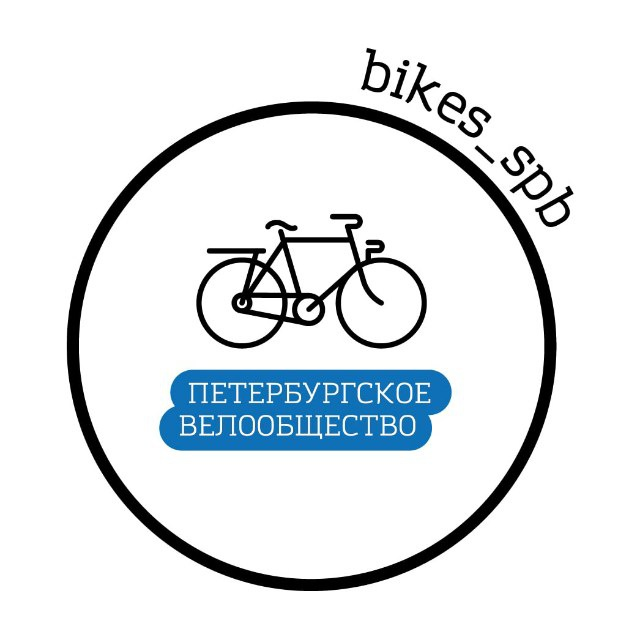

<p align="center">
  
</p>

# VeloHelp · Велопомощь

Взаимопомощь велосипедистов в Санкт-Петербурге — проект [Петербургского велообщества](https://github.com/Saint-Petersburg-cycling-society).
Peer assistance for cyclists in Saint Petersburg, by the Saint Petersburg Cycling Society.

[](https://github.com/Saint-Petersburg-cycling-society/VeloHelp-bot/actions/workflows/ci.yml)
[](LICENSE)
[](https://t.me/bike_help_bot)

[Открыть бота / Open bot](https://t.me/bike_help_bot) · [Документация / Docs](docs/README.md) · [Участие / Contributing](CONTRIBUTING.md) · [Эмодзи / Emoji](https://t.me/addemoji/VeloHelp_bikes_spb_by_bike_help_bot)

## RU

Telegram-бот добровольной взаимопомощи велосипедистов. Приложение — AGPL-3.0-only;
`teloxide-ui` — отдельная MIT-зависимость. Победителя заявки определяет SQLite,
Telegram представляет состояние и передаёт команды через привязанные к пользователю capabilities.

После `/start` и явного согласия доступны два независимых сценария: настройка
помощника и заявка. Заявка: одна кнопка проблемы или свой текст → геопозиция
→ предпросмотр и публикация → рассылка → атомарный приём → закрытие/отказ помощника. Есть `/active`, `/source`,
экспорт JSON и подтверждаемое удаление данных. Только личные чаты.
Район заявки определяется локально по границам OSM, без внешнего геокодера.
Все 18 кнопок районов находятся на одном экране, без страниц.
Тип помощи и пауза уведомлений доступны отдельно в «Настройки».
`/start` открывает новое главное сообщение, сохраняя временный выбор районов;
кнопки редактируют экран, в котором нажаты.
Точные координаты автоматически не входят в рассылку и удаляются из БД при закрытии.
Участники принятой пары могут открыть Telegram-профиль друг друга; возможность
написать зависит от настроек приватности Telegram.

**Статус:** локально проверяемый пилот. Полный сценарий в живом Telegram и публичный
запуск требуют отдельной проверки. Временные черновики живут в памяти до часа;
после перезапуска они сбрасываются, заявки/настройки восстанавливаются из БД.
Входящие update offsets не сохраняются: повторная доставка безопасна для переходов
через атомарные guard-условия, старые capabilities после рестарта отклоняются.

### Проверка без токена

Переменные загружаются из окружения процесса; `.env` автоматически не читается.
Для временной локальной проверки:

```sh
DATABASE_URL=sqlite://target/preflight.sqlite \
SOURCE_URL=https://example.org/source CONSENT_VERSION=test \
cargo run --locked -- --check
```

`--check` применяет миграции и удаляет устаревшие точные координаты закрытых заявок,
проверяет границы районов, адресный датасет, integrity, WAL, FULL, foreign keys и busy timeout. Сеть и токен не нужны. Runtime может выдавать архив исходников через `/source`
при заданном `SOURCE_ARCHIVE_PATH`; SOURCE_URL тогда ведёт на `/start source` этого бота.
`example.org/source` — только тестовая подстановка: перед реальным запуском нужен
публичный URL именно Corresponding Source этой инстанции.

```sh
cargo fmt --all -- --check
cargo clippy --all-targets --all-features --locked -- -D warnings
cargo test --all-features --locked
```

Production packaging: Alpine/musl builder → scratch → rootless Podman.
См. `docs/DEPLOYMENT.md`; токен задаётся через `TELOXIDE_TOKEN` в защищённом env-file.
Не устанавливать application binary непосредственно в host rootfs.

### Эмодзи

46 оригинальных SVG, PNG/WEBP 100×100 и превью лежат в `assets/icons/`.
Чёрный контур, белый диск, синий #137BB2 — по референсу bikes_spb.
Пак [зарегистрирован в Telegram](https://t.me/addemoji/VeloHelp_bikes_spb_by_bike_help_bot);
все 46 `custom_emoji_id` заполнены. Если Telegram отклоняет эмодзи, кнопки
сохраняют текстовые подписи без технических semantic IDs.
См. `assets/icons/README.md`.

Документация: `docs/SPEC.md`, `ARCHITECTURE.md`, `STATE_MACHINES.md`, `DATA_MODEL.md`,
`SECURITY_PRIVACY.md`, `DESIGN_SYSTEM.md`, `ROADMAP.md`, `REVIEW_2026-10-10.md`.

### Карта и время прибытия

На шаге места есть стандартная reply-кнопка «Отправить местоположение» с
`request_location=true` ([Bot API](https://core.telegram.org/bots/api#keyboardbutton)).
Также можно отправить выбранную точку вложением Telegram. После получения точки
клавиатура убирается; район и ближайший адрес определяются локально.
Принятое геосообщение пользователя удаляется после обновления черновика;
ошибка удаления не прерывает заявку. Для снятия reply-клавиатуры Telegram
требует отдельное временное сообщение, которое затем также удаляется.

«Помогу через…» в исходном приглашении открывает интервалы 5–15, 15–30,
30–60, 60–120 минут или ввод точного числа 1–240. Открытие выбора не принимает
заявку. Выбор интервала или валидное число выполняют атомарный приём вместе
с оценкой времени; проигравший помощник не перезаписывает оценку победителя.

Исходная карточка обновляется на месте: имя другого участника — кликабельная
ссылка, ниже время прибытия по Москве, ближайший адрес и нативная карта
`InputRichBlockMap`. Отдельных кнопок контакта/карты и отдельного сообщения
с геоточкой нет. До приёма рассылка содержит район и приблизительную зону; точная точка, адрес и
имя-ссылка доступны только участникам текущей пары.

### Одно основное сообщение

Предпросмотр → публикация → приём/закрытие используют одно основное Rich-сообщение
с тем же message ID. Отдельное «Заявка опубликована» не отправляется. Кнопки
главной, настроек и списка заявок редактируют сообщение, в котором нажаты.
Команды `/start`, `/help`, `/active`, `/cancel` создают новый основной экран внизу
чата; после успешной отправки старый экран удаляется, его capabilities отзываются.
Ошибка удаления повторяется в polling pass. При одной
активной заявке сразу открывается карточка; при нескольких — список с кнопками
`OpenRequest`, и выбранная карточка заменяет список. `OpenRequest` использует
существующую иконку `status.open` и проверяет доступность через backend.

Переход в меню снимает связь surface с заявкой: её background refresh не может
заменить открытые настройки/главную. Приглашения помощникам — отдельные уведомления;
смена их версии редактирует имеющуюся карточку в текущей сессии. `/active` убирает
дубли выбранной карточки после успешного отображения в основном сообщении.
Метаданные surface пока живут только в памяти: после restart первое открытие
создаёт новый основной экран, старые capabilities не работают.

[Telegram ограничивает редактирование сообщений с reply-клавиатурами](https://core.telegram.org/bots/api#updating-messages).
Поэтому request_location вынесен во временное тихое сообщение; после геоточки,
возврата или отмены оно и сообщение снятия клавиатуры удаляются. При первом
`/start` после запуска неизвестную клавиатуру не пытаются снимать видимым
служебным сообщением. При ошибке удаления
runtime повторяет cleanup в polling pass. Основная карточка всегда без reply_markup.
Новый основной экран при ошибке редактирования допустим только для
`MessageToEditNotFound`/`MessageCantBeEdited`; сетевые и прочие ошибки не создают дубль.

Регрессия проверяет не только успешный ответ mock: stub запрещает редактирование
reply-keyboard сообщений. Smoke считает успешные Send/Edit/Delete, проверяет один
оставшийся экран: кнопки сохраняют message ID через публикацию, match и resolve,
а команды создают новый экран и удаляют прежний. Проверены несколько заявок,
кнопка в отдельном приглашении и повторная попытка после временной ошибки карты.
Причина дублей локализована в адаптере VeloHelp; путь `SurfaceWorker::project`
в закреплённой версии teloxide-ui использует редактирование существующей surface.
Неподтверждённые изменения библиотеки в этот fix не включены.

### Примерное место в приглашении

В приглашении помощнику есть район и карта примерной зоны около 1 × 1 км.
Маркер показывает центр зоны, а не место встречи. После выбора времени и приёма
та же карточка показывает точную точку и адрес. Повторные отправки используют
один и тот же центр, без случайного смещения. В предпросмотре публикации requester
видит пояснение о таком раскрытии.

## EN

A Telegram bot for voluntary peer assistance between cyclists. The application is
AGPL-3.0-only; `teloxide-ui` remains a separate MIT dependency. SQLite determines
the winner; Telegram presents state and invokes actor-bound capabilities.

After `/start` and explicit consent, users can independently configure help or
request it. A request takes one problem button or free text → explicit location
→ preview and publish → fan-out → atomic accept → resolve/withdraw. `/active`, `/source`, JSON
export and confirmed data deletion are available. Private chats only.
Request districts are resolved locally from OSM boundaries without a remote
geocoder. District selection shows all 18 buttons on one screen, without pagination.
Help types and notification pause are in a separate Settings screen.
`/start` opens a new home message while retaining temporary district selections;
buttons edit the message in which they are pressed.
Exact coordinates are excluded from automatic fan-out and cleared on closure.
Matched participants can open each other's Telegram profile; messaging remains
subject to Telegram privacy settings.

**Status:** locally testable pilot. The complete live Telegram flow and public launch
need separate validation. Temporary drafts expire after an hour and reset on restart;
requests/settings recover from SQLite. Incoming update offsets are not persisted;
atomic transition guards protect against replay and old capabilities are rejected
across restarts.

### Offline preflight

Configuration comes from the process environment; `.env` is not loaded automatically.

```sh
DATABASE_URL=sqlite://target/preflight.sqlite \
SOURCE_URL=https://example.org/source CONSENT_VERSION=test \
cargo run --locked -- --check
```

`--check` applies migrations, clears residual exact coordinates on closed requests,
and verifies district boundaries, the address dataset, integrity, WAL, FULL, foreign keys and busy timeout. No network or token. With `SOURCE_ARCHIVE_PATH`, the runtime can serve a source
archive through `/source`; SOURCE_URL then points to this bot’s `/start source` link.
The example source URL is a test placeholder; real deployment needs the public
Corresponding Source URL for this particular instance.

```sh
cargo fmt --all -- --check
cargo clippy --all-targets --all-features --locked -- -D warnings
cargo test --all-features --locked
```

Production packaging: Alpine/musl builder → scratch → rootless Podman.
See `docs/DEPLOYMENT.md`; set `TELOXIDE_TOKEN` through a protected environment file.
Do not install the application executable directly into the host root filesystem.

### Emoji

46 original SVG sources, PNG/WEBP 100×100 exports and a preview are in `assets/icons/`.
Black contours, white discs and blue #137BB2 follow the bikes_spb reference.
The pack is [registered in Telegram](https://t.me/addemoji/VeloHelp_bikes_spb_by_bike_help_bot);
all 46 `custom_emoji_id` fields are populated. Buttons retain accessible text
without exposed semantic IDs if Telegram denies custom emoji.
See `assets/icons/README.md`.

Documentation: `docs/SPEC.md`, `ARCHITECTURE.md`, `STATE_MACHINES.md`, `DATA_MODEL.md`,
`SECURITY_PRIVACY.md`, `DESIGN_SYSTEM.md`, `ROADMAP.md`, `REVIEW_2026-10-10.md`.

### Map and arrival estimate

The location step uses a native reply button, “Отправить местоположение”,
with `request_location=true` ([Bot API](https://core.telegram.org/bots/api#keyboardbutton)).
A manually chosen Telegram location attachment also works. Receiving the point
removes the keyboard; district and nearby address lookup are local.
The accepted incoming location message is deleted after updating the draft;
a deletion failure does not interrupt the request. Telegram requires a separate
temporary message to remove a reply keyboard; that message is also deleted.

“Помогу через…” opens 5–15, 15–30, 30–60 or 60–120 minute ranges, or exact
minutes from 1 to 240. Opening the picker does not accept the request. Choosing
a range or submitting a valid number atomically accepts with the estimate;
a losing helper cannot replace the winner’s estimate.

The original card updates in place: the other participant’s name is a clickable
profile link, followed by arrival time in Moscow, a nearby address and a native
`InputRichBlockMap`. There are no separate contact/map buttons or location
messages. Pre-match fan-out contains the district and an approximate zone; the exact point, address and
profile link are available only to the current matched pair.

### One primary message

Preview → publication → acceptance/closure use one primary Rich Message with
the same message ID. No separate publication confirmation is sent. Home, settings
and request-list buttons edit the message carrying the clicked button. Commands
`/start`, `/help`, `/active`, `/cancel` create a new primary screen at the bottom
of the chat. After a successful send, the previous screen is deleted and its
capabilities revoked; failed deletion is retried on polling passes. One active request
opens directly; multiple requests show an `OpenRequest` button list, replaced
by the selected card. `OpenRequest` reuses `status.open` and checks availability
through the backend.

Menu navigation detaches the surface from its request: background refresh cannot
replace settings/home. Helper invitations remain separate notifications; new waves
edit an existing card in the current session. `/active` removes duplicates of the
selected card after successful rendering in the primary message. Surface metadata
is still in memory: the first opening after restart creates a new primary screen
and old capabilities no longer work.

[Telegram restricts editing messages with reply keyboards](https://core.telegram.org/bots/api#updating-messages).
The native request_location button therefore uses a temporary silent carrier.
Receiving a point, returning or cancelling removes it and the keyboard-removal
message; failed cleanup is retried on polling passes. At a fresh `/start`, an
unknown keyboard state does not trigger a visible cleanup message. The primary card always
has no reply_markup. A new main screen after edit failure is allowed only for
`MessageToEditNotFound`/`MessageCantBeEdited`; network/other errors never create a copy.

Regression checks go beyond a successful mock response: the stub rejects edits
of reply-keyboard messages. Smoke counts successful Send/Edit/Delete and verifies
one surviving screen: buttons preserve the message ID through publication, match
and resolution; commands create a new screen and delete its predecessor. Coverage
includes multiple requests, a button in a separate invitation and transient map retry.
Duplicate creation is in VeloHelp’s adapter; the pinned teloxide-ui
`SurfaceWorker::project` edits the existing surface. No unsubstantiated library
changes are included in this fix.

### Approximate invitation location

Helper invitations include the district and a map of an approximate 1 × 1 km zone.
The marker is the zone center, not a meeting place. Selecting an estimate and accepting
updates the same card with the exact point and address. Repeated sends use the same
center without random jitter. Requester preview explains this disclosure before publication.
