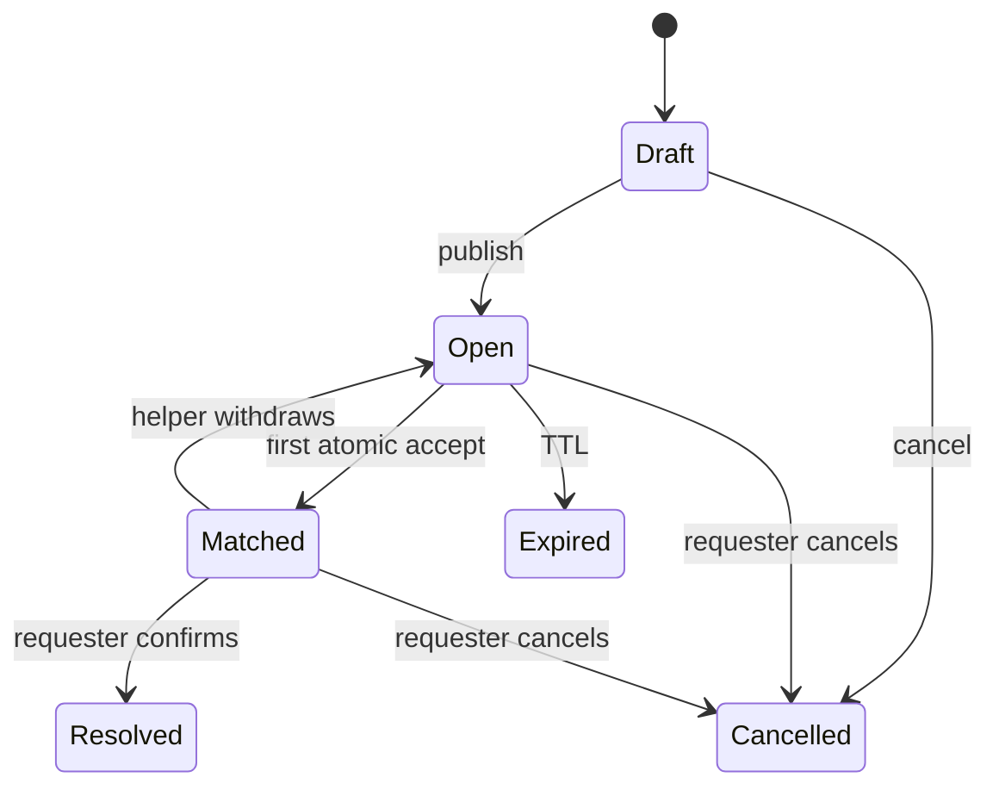
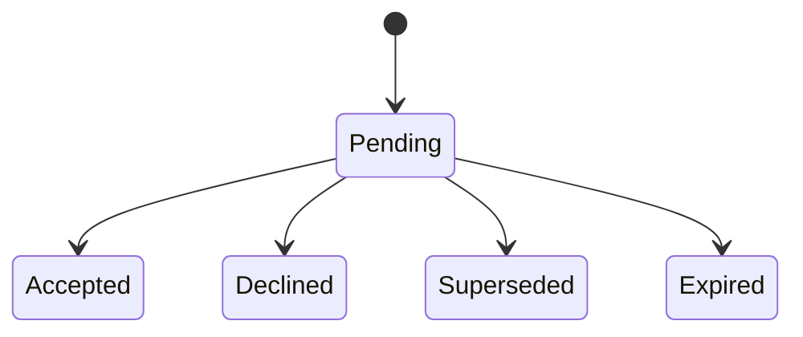

# State machines / Машины состояний

## RU

### HelpRequest

`Matched -> Open` создаёт новый request version / новую dispatch wave.
Старые capabilities не воскресают.

### Dispatch

### Race

Первый conditional `UPDATE ... WHERE status='open'` выигрывает. На SQLite
writers сериализуются; последующий writer уже не удовлетворяет `WHERE`.

## EN

### HelpRequest

`Matched -> Open` creates a new request version / new dispatch wave.
Old capabilities MUST NOT be resurrected.

### Dispatch

### Race

The first conditional `UPDATE ... WHERE status='open'` wins. On SQLite
writers are serialized; a later writer no longer satisfies `WHERE`.
