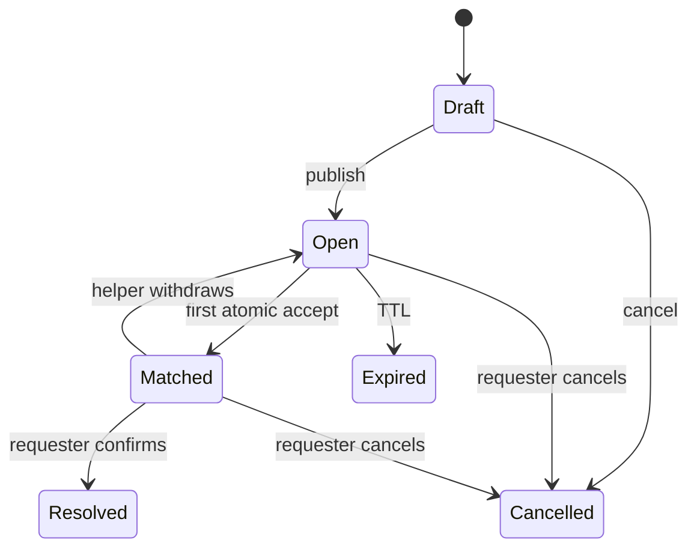
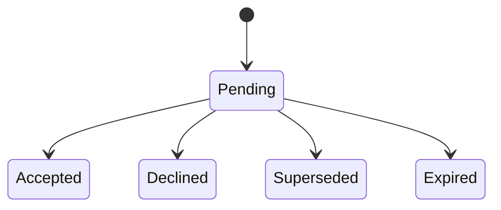

# State machines / Машины состояний

## RU

### HelpRequest

`Matched -> Open` создаёт новую версию request и новую волну рассылки; старые
capabilities не воскресают. Отмена из `Matched` закрывает dispatches и очищает
matched helper, время пары, ETA и точную координату в одной транзакции. Если
отмена пересекается с отзывом помощи, итог соответствует одному из порядков:
`Matched -> Cancelled` либо `Matched -> Open -> Cancelled`.

### Dispatch

### Race

Первый conditional `UPDATE ... WHERE status='open'` выигрывает. На SQLite
writers сериализуются; последующий writer уже не удовлетворяет `WHERE`.

### Проверенное поведение пилота (2026-10-10)

Accept требует current request version, pending dispatch той же wave и enabled
helper; self-accept и попытка без dispatch дают `Forbidden`, old version — `Stale`.
Отмена атомарно инвалидирует pending/accepted dispatches, снимает matched
helper и matched time, очищает ETA и exact point.
Resolve и Expire также очищают point. Withdraw после истечения TTL переводит
заявку в `Expired`; до TTL — в `Open`. Fanout не возрождает старые dispatches
в той же версии и не создаёт уведомлений для закрытой заявки.

Черновик UI: `Description → Location → Preview`. Одиночный выбор проблемы или
свой текст автоматически переводят к месту; валидная точка переводит к preview.
Редактирование текста при сохранённой точке сразу возвращает к preview.
Publish остаётся явным действием. Эти шаги не являются доменным состоянием.

Экран помощника показывает все 18 районов, шесть технических проблем, происшествие,
выбор всех поломок и переключатель уведомлений. «Сохранить» отключено, пока
включённому помощнику не выбраны район и проблема. После записи в БД тот же
экран становится главной с подтверждением сохранения и статусом регистрации.
Черновик после сохранения сбрасывается; повторное открытие читает профиль из БД.
Главная и `/start` сохраняют несохранённый черновик до TTL. Кнопки редактируют
сообщение, на котором нажаты; команды создают новый экран внизу чата.
Карточки помощника, включая отменённые и истёкшие, содержат «Главная».

На шаге Location можно отправить точку или написать улицу, дом и корпус.
Локальный поиск автоматически выбирает единственный адрес; при неоднозначности
показывает до шести вариантов. Точка адреса находится внутри публичного контура
здания и может отличаться от входа; preview предупреждает об этом. «Уточнить адрес»
открывает шаг Address: текст до 200 символов исправляет подпись, сохраняя точку.
Возврат отменяет только ввод, а не ранее сохранённый адрес. Новая геоточка
сбрасывает адрес и варианты прежнего поиска. Старые callback выбора адреса отклоняются.
Ошибку карточки после commit публикации бот объясняет явно: заявка уже опубликована,
её можно открыть через `/active`; повторная отправка не создаёт дубликат.

Заголовки экранов выводятся обычным текстом без крупного Rich Heading.

### Автоматический smoke

`cargo test --all-features --locked telegram::runtime::transport_tests`
прогоняет реальные обработчики сообщений и callback через локальный HTTP API
и настоящую SQLite после миграций. Реальные Telegram ID и токен не используются.
Проверяются все 18 районов, сохранение и восстановление профиля в новой сессии,
пауза/возобновление уведомлений, `/start`, устаревшие и повторные кнопки,
`Open → Matched → Resolved`, `Matched → Open → Matched → Cancelled`, отказ от
уведомления и `Open → Expired`. Точка удаляется после закрытия; доступ к контакту
закрывается после выхода из пары. Отдельные integration tests проверяют гонки
accept/cancel, одного победителя и миграции. Пользовательские клики не требуются.

### Выбор прибытия и клавиатура места

UI: `Invitation → ArrivalRanges → ArrivalNumber`, с возвратом к вариантам или
приглашению. `/start`, главная и `/active` сбрасывают временный выбор. Переход
`Open → Matched` происходит только после выбора/ввода времени. Изменение версии
или выход заявки из Open очищает незавершённый ввод у остальных помощников.
Время хранится вместе с победителем, независимо от UI. Withdraw очищает оценку;
новая wave начинает новый выбор. Старые Matched-заявки после миграции не имеют ETA.

Reply-клавиатура места включается при входе в Location и удаляется при выходе,
`/start`, `/cancel` или `/active`. Telegram не позволяет менять её редактированием
сообщения: кнопка живёт во временном служебном сообщении, которое удаляется
после выхода из Location. Основное Rich-сообщение не получает reply_markup
и сохраняет message ID на всех шагах.

Smoke проверяет request_location, снятие клавиатуры, emoji fallback, диапазоны,
невалидный/точный ввод, потерянную гонку, повторный callback, редактирование
того же message ID, карту/ссылку/адрес только внутри пары, очистку и восстановление
после restart. Интеграционные тесты проверяют ETA победителя и upgrade 4 → 5.

### Одно основное сообщение

Предпросмотр → публикация → приём/закрытие используют одно основное Rich-сообщение
с тем же message ID. Отдельное «Заявка опубликована» не отправляется. Кнопки
главной, настроек и списка заявок редактируют сообщение, в котором нажаты.
Команды `/start`, `/help`, `/active`, `/cancel` создают новый основной экран внизу
чата; после успешной отправки старый экран удаляется, его capabilities отзываются.
Ошибка удаления повторяется в polling pass. При одной
активной заявке сразу открывается карточка; при нескольких — список с кнопками
`OpenRequest`, и выбранная карточка заменяет список. `OpenRequest` использует
существующую иконку `status.open` и проверяет доступность через backend.

Переход в меню снимает связь surface с заявкой: её background refresh не может
заменить открытые настройки/главную. Приглашения помощникам — отдельные уведомления;
смена их версии редактирует имеющуюся карточку в текущей сессии. `/active` убирает
дубли выбранной карточки после успешного отображения в основном сообщении.
Метаданные surface пока живут только в памяти: после restart первое открытие
создаёт новый основной экран, старые capabilities не работают.

[Telegram ограничивает редактирование сообщений с reply-клавиатурами](https://core.telegram.org/bots/api#updating-messages).
Поэтому request_location вынесен во временное тихое сообщение; после геоточки,
возврата или отмены оно и сообщение снятия клавиатуры удаляются. При первом
`/start` после запуска неизвестную клавиатуру не пытаются снимать видимым
служебным сообщением. При ошибке удаления
runtime повторяет cleanup в polling pass. Основная карточка всегда без reply_markup.
Новый основной экран при ошибке редактирования допустим только для
`MessageToEditNotFound`/`MessageCantBeEdited`; сетевые и прочие ошибки не создают дубль.

Регрессия проверяет не только успешный ответ mock: stub запрещает редактирование
reply-keyboard сообщений. Smoke считает успешные Send/Edit/Delete, проверяет один
оставшийся экран: кнопки сохраняют message ID через публикацию, match и resolve,
а команды создают новый экран и удаляют прежний. Проверены несколько заявок,
кнопка в отдельном приглашении и повторная попытка после временной ошибки карты.
Причина дублей локализована в адаптере VeloHelp; путь `SurfaceWorker::project`
в закреплённой версии teloxide-ui использует редактирование существующей surface.
Неподтверждённые изменения библиотеки в этот fix не включены.

### Примерное место в приглашении

Open/helper: coarse map сохраняется при переходах Invitation → ArrivalRanges →
ArrivalNumber. Matched/winner: карта в том же message ID становится точной, у
проигравших исчезает. Withdraw/Open: снова тот же coarse center, независимо от
новой wave. Cancel/Resolve/Expired: карты нет. Restart + /active восстанавливает
то же округление из БД. Unit tests проверяют одинаковый центр для разных точек
одной ячейки и покрытие углов фиксированным радиусом. Smoke проверяет несколько
helpers, отсутствие точного адреса/профиля до match, чужой actor, picker, точный
match, loser, withdraw, restart и resolve.

## EN

### HelpRequest

`Matched -> Open` creates a new request version and dispatch wave; old capabilities
MUST NOT be resurrected. Cancellation from `Matched` closes dispatches and clears
the matched helper, match time, ETA and exact point in one transaction. If cancel
races with withdrawal, the result is equivalent to `Matched -> Cancelled` or
`Matched -> Open -> Cancelled`.

### Dispatch

### Race

The first conditional `UPDATE ... WHERE status='open'` wins. On SQLite
writers are serialized; a later writer no longer satisfies `WHERE`.

### Verified pilot behavior (2026-10-10)

Accept requires the current request version, a pending dispatch in that wave and
an enabled helper. Self-accept/no dispatch yields `Forbidden`, an old version yields
`Stale`. Cancellation atomically invalidates pending/accepted dispatches, clears
the matched helper/time, ETA and exact point. Resolve and Expire also clear it. Withdrawal after TTL transitions to
`Expired`; otherwise to `Open`. Fanout never revives dispatches in the same version
or creates notifications for a closed request.

UI draft: `Description → Location → Preview`. A single problem choice or free
text advances to location; a valid point advances to preview. Editing text with a
retained point returns directly to preview. Publish remains explicit. These
steps are not authoritative domain state.

Helper setup displays all 18 districts, six technical problems, accidents, an
all-technical toggle and notifications. Save is disabled until an enabled helper
selects an area and a problem. After the DB write, the same message becomes Home
with a save confirmation and registration status. Saving clears the temporary
draft; reopening reads the DB profile. Home and `/start` preserve unsaved drafts
until their TTL. Buttons edit their message; commands create a fresh bottom screen.
Helper cards, including cancelled and expired requests, offer Home navigation.

Location accepts a point or a street, house and corpus. Local search advances a
unique address automatically, or shows up to six choices. The building point lies
inside a public outline and may differ from the entrance; preview explains this.
Edit Address opens Address: up to 200 characters change the label and keep the
point. Back cancels input without clearing the previous address. A new location
clears the old manual label and search choices. Stale address callbacks are rejected.
If projection fails after publication commits, the bot explicitly confirms that
the request exists and can be opened with `/active`; replay cannot duplicate it.

Screen titles use ordinary text rather than oversized Rich Heading blocks.

### Automated smoke

`cargo test --all-features --locked telegram::runtime::transport_tests`
exercises the actual message/callback handlers through a local HTTP API and
real migrated SQLite. It uses no real Telegram IDs or bot token.
Coverage includes all 18 districts, saving and recovering a profile in a fresh
session, pausing/resuming notifications, `/start`, stale/replayed buttons,
`Open → Matched → Resolved`, `Matched → Open → Matched → Cancelled`, declining a
notification and `Open → Expired`. Closing clears the point; leaving a match
removes contact access. Separate integration tests exercise concurrent accepts, accept/decline and
withdraw/cancel races against independent SQLite connections, plus migrations.
No user clicks are required.

### Arrival picker and location keyboard

UI: `Invitation → ArrivalRanges → ArrivalNumber`, with back navigation to
ranges or invitation. `/start`, home and `/active` clear the temporary picker.
`Open → Matched` occurs only after choosing/submitting an estimate. A changed
version or transition out of Open clears unfinished input for other helpers.
The estimate is stored with the winner, independent of UI. Withdrawal clears it;
a new wave starts a new choice. Legacy matches have no ETA after migration.

The location reply keyboard is enabled on entering Location and removed on
leaving it, `/start`, `/cancel` or `/active`. Telegram cannot change reply keyboards
by editing messages: the button lives in a temporary carrier deleted when leaving
Location. The primary Rich Message has no reply_markup and keeps its message ID
across all steps.

Smoke coverage checks request_location, keyboard removal, emoji fallback, ranges,
invalid/exact input, a lost race, replay, editing the same message ID, pair-only
map/profile/address, clearing and restart recovery. Integration tests verify the
winner’s ETA and upgrade from migration 4 to 5.

### One primary message

Preview → publication → acceptance/closure use one primary Rich Message with
the same message ID. No separate publication confirmation is sent. Home, settings
and request-list buttons edit the message carrying the clicked button. Commands
`/start`, `/help`, `/active`, `/cancel` create a new primary screen at the bottom
of the chat. After a successful send, the previous screen is deleted and its
capabilities revoked; failed deletion is retried on polling passes. One active request
opens directly; multiple requests show an `OpenRequest` button list, replaced
by the selected card. `OpenRequest` reuses `status.open` and checks availability
through the backend.

Menu navigation detaches the surface from its request: background refresh cannot
replace settings/home. Helper invitations remain separate notifications; new waves
edit an existing card in the current session. `/active` removes duplicates of the
selected card after successful rendering in the primary message. Surface metadata
is still in memory: the first opening after restart creates a new primary screen
and old capabilities no longer work.

[Telegram restricts editing messages with reply keyboards](https://core.telegram.org/bots/api#updating-messages).
The native request_location button therefore uses a temporary silent carrier.
Receiving a point, returning or cancelling removes it and the keyboard-removal
message; failed cleanup is retried on polling passes. At a fresh `/start`, an
unknown keyboard state does not trigger a visible cleanup message. The primary card always
has no reply_markup. A new main screen after edit failure is allowed only for
`MessageToEditNotFound`/`MessageCantBeEdited`; network/other errors never create a copy.

Regression checks go beyond a successful mock response: the stub rejects edits
of reply-keyboard messages. Smoke counts successful Send/Edit/Delete and verifies
one surviving screen: buttons preserve the message ID through publication, match
and resolution; commands create a new screen and delete its predecessor. Coverage
includes multiple requests, a button in a separate invitation and transient map retry.
Duplicate creation is in VeloHelp’s adapter; the pinned teloxide-ui
`SurfaceWorker::project` edits the existing surface. No unsubstantiated library
changes are included in this fix.

### Approximate invitation location

Open/helper retains the coarse map through Invitation → ArrivalRanges → ArrivalNumber.
Matched/winner changes that same message ID to the exact map and removes it from
losers. Withdraw/Open restores the same coarse center regardless of the new wave.
Cancel/Resolve/Expired have no map. Restart + /active reproduce quantization from
the DB. Unit tests verify one center for different points in a cell and a fixed
radius covering city cell corners. Smoke checks multiple helpers, no exact address/
profile before matching, foreign actors, the picker, winner/loser, withdrawal,
restart and resolution.
