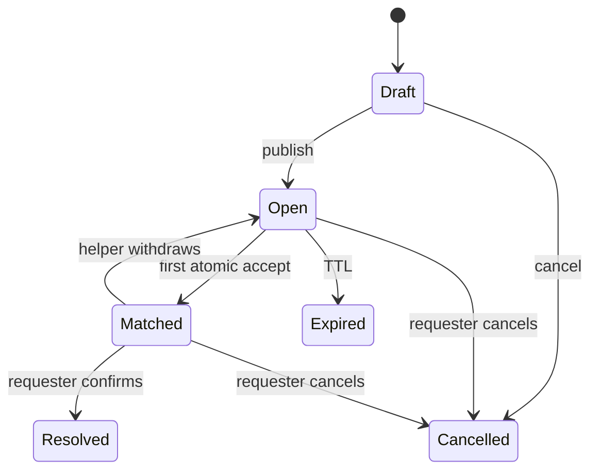
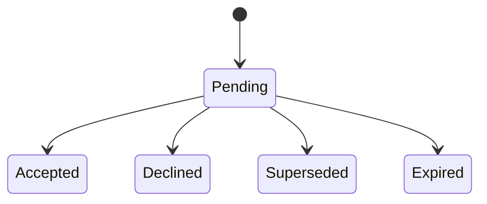

# State machines / Машины состояний

## RU

### HelpRequest

`Matched -> Open` создаёт новый request version / новую dispatch wave.
Старые capabilities не воскресают.

### Dispatch

### Race

Первый conditional `UPDATE ... WHERE status='open'` выигрывает. На SQLite
writers сериализуются; последующий writer уже не удовлетворяет `WHERE`.

## EN

`HelpRequest` moves through Draft/Open/Matched/terminal states. A helper
withdrawal reopens a new logical request version and never reuses old
capabilities.

Dispatches are Pending/Accepted/Declined/Superseded/Expired.

Accept races are resolved by the first successful conditional database update;
later writers observe that the request is no longer open.
